  

# 🛡️ Awesome Endpoint Security Sensor & Agent

  <strong>Curated Directory of Enterprise SaaS Solutions & Production Open-Source Agents for Threat Detection, eBPF Kernel Telemetry, Fleet Management, DFIR & Host Intrusion Prevention</strong>

  
  
  
  

---

**Last updated: November 2026** 🌟 Star if you find it helpful! 🌟

## 📌 Executive Overview

This comprehensive repository indexes leading **SaaS security platforms** and battle-tested **open-source sensor codebases** in the **Endpoint Security Sensor & Agent** domain. 

Endpoint sensors represent critical software agents operating across corporate workstations, Linux cloud workloads, bare-metal servers, and container nodes to capture low-level telemetry, detect zero-day exploits, enforce granular security policies, and trigger automated remediation. 

Whether you need a commercial multi-OS agent with machine-learning threat prevention (CrowdStrike, SentinelOne, Microsoft Defender) or an inspectable, auditable self-hosted sensor pipeline (Wazuh, Falco, osquery, Tetragon), this curated index breaks down pricing, free-tier limits, architectures, and market positioning.

### 🎯 Key Architectural Categories
- 🛡️ **Prevention Agents (EPP/EDR)**: Intercept system calls in real-time, terminate malicious processes at the kernel/eBPF level, and quarantine artifacts (e.g., CrowdStrike, SentinelOne, Defender, Santa).
- 🔍 **Detection & Investigation Agents (DFIR/FIM)**: Execute continuous host telemetry capture, rule-based log analysis, rootkit detection, and deep live forensic hunts (e.g., Wazuh, Velociraptor, OpenEDR, OSSEC).
- 📊 **Telemetry & Observability Shippers**: Collect structured system events, performance metrics, and application traces for SIEM ingestion (e.g., OpenTelemetry Collector, Grafana Alloy, Elastic Agent, Datadog Agent).

---

## 📑 Table of Contents

- [📊 Sector Overview & Market Dynamics](#-sector-overview--market-dynamics)
- [💼 SaaS/Hosted Platforms](#-saashosted-platforms)
- [🔓 Open-Source GitHub Projects](#-open-source-github-projects)
- [🧩 Suggested Open-Source Deployment Stacks](#-suggested-open-source-deployment-stacks)
- [🤝 How to Contribute](#-how-to-contribute)
- [💖 Support](#-support)
- [⭐ Star History](#-star-history)
- [⚖️ Disclaimer](#-disclaimer)

---

## 📊 Sector Overview & Market Dynamics

The global endpoint security market is valued at approximately **$19.5B – $21.5B (2025/2026)** and is projected to expand at a **10.5% – 12.7% CAGR** toward $37B+ by the early 2030s. Structurally, the sector remains **moderately fragmented**: while a top tier of enterprise giants (Microsoft, CrowdStrike, Broadcom, SentinelOne, Sophos) captures massive enterprise spend through consolidated XDR and cloud-delivered security suites, thousands of specialized MDR providers, niche telemetry collectors, and regional compliance vendors continue to maintain substantial aggregate share.

---

## 💼 SaaS/Hosted Platforms

| 🏢 Product / Vendor | 📈 Company Size (Revenue / Valuation) | 💵 Starting Tier Pricing | 🎁 Free Tier / Free Trial Limits | ⚙️ Key Features & Architecture | 💻 Supported Platforms |
| :--- | :--- | :--- | :--- | :--- | :--- |
| **Microsoft Defender for Endpoint** | **$3.1T+ Market Cap** (~$245B+ Annual Revenue; Security revenue >$20B) | **$3.00/user/month** (Plan 1 standalone) or **$5.20/user/month** (Plan 2 standalone); included in M365 E3/E5 suites | **90-day free trial**; covers up to **250 evaluation licenses** (up to 5 concurrent devices per user license) | Behavioral EDR, threat analytics, automated investigation, cloud-native XDR integration | Windows, macOS, Linux, Android, iOS |
| **Datadog Agent** | **$43B+ Market Cap** (~$2.6B+ Annual Revenue) | **$15.00/host/month** (Infrastructure Pro, annual commitment) | **Free tier available for up to 5 hosts** with 1-day metric data retention; full-feature trial for 14 days | Unified telemetry collection (metrics, traces, logs), eBPF network and runtime tracking | Linux, Windows, macOS, Docker, Kubernetes |
| **CrowdStrike Falcon Agent** | **$75B+ Market Cap** (~$4.0B+ Annual Revenue) | **$59.99/device/month** (Falcon Go, billed annually, up to 100 devices); Pro at $99.99/device/month | **15-day free trial**; cloud-native sensor evaluation without reboots, up to test limits | Kernel-level sensor, real-time Threat Graph, AI prevention, minimal memory footprint | Windows (including legacy), Linux (ARM64, x86_64), macOS, ChromeOS (agentless) |
| **Carbon Black Sensor** (Broadcom) | **Broadcom ($800B+ Market Cap)** (Enterprise Security division ~$5B+ rev) | **~$40.00 – $60.00/endpoint/year** (starting baseline estimate, typically quote-based with multi-year contract) | **90-day free trial** ("Try & Buy" POC via Broadcom Support Portal, 1 trial per corporate Site ID) | Kernel-level telemetry, continuous behavioral recording, attack chain visualization | Windows, macOS, Linux |
| **SentinelOne Singularity Agent** | **$7.5B+ Market Cap** (~$800M+ Annual Revenue) | **$179.99/endpoint/year** (~$15.00/endpoint/month, Singularity Complete tier) | **30-day evaluation trial** (sales-managed Proof of Concept, typically up to 25–50 test endpoints) | Autonomous AI behavioral engine, automated ransomware rollback, integrated identity security | Windows (Server & Client), Linux (RHEL, Ubuntu, ARM64 Graviton), macOS |
| **Elastic Agent** (Elastic Cloud) | **$9.0B+ Market Cap** (~$1.4B+ Annual Revenue) | **$95.00/month** (Elastic Cloud Standard starting cluster) or free self-managed open-source binary | **14-day free trial** on Elastic Cloud (provisioned with 8GB RAM, 240GB storage across AWS/GCP/Azure) | Unified shipper for Elastic Security & Observability, fleet management, built-in eBPF and Defend integration | Linux, Windows, macOS |
| **Tanium Client** | **~$9.0B Valuation** (Private enterprise, ~$600M+ ARR) | **$8.00/endpoint/month** ($12,000/month minimum entry for 1,500 endpoints via Azure/AWS marketplace) | **30-day evaluation trial** (vendor-assisted Proof of Concept / Tanium Cloud POC environment) | Linear-chain peer-to-peer architecture, real-time fleet asset query, unified endpoint management and IR | Windows, macOS, Linux |
| **Sophos Intercept X Agent** | **~$4.0B Valuation** (Private, Thoma Bravo subsidiary; ~$1.1B+ ARR) | **~$60.00/user/year** (~$5.00/user/month for Intercept X Advanced baseline) | **30-day free trial** with full functionality via Sophos Central, limited to 25–50 test endpoints | Deep learning malware detection, CryptoGuard anti-ransomware rollback, endpoint DLP | Windows, Windows Server, macOS, Linux |
| **Trellix Endpoint Security Agent** | **~$2.5B Valuation** (Private, Symphony Technology Group; ~$1.5B+ ARR) | **~$40.00/endpoint/year** (~$3.33/endpoint/month starting baseline for ENS Essentials) | **60-day free trial**; defaults to **5 trial licenses** with full Adaptive Threat Protection & EDR features | Unified endpoint security suite (formerly McAfee/FireEye), host intrusion prevention, ePO management | Windows, macOS, Linux |
| **Cybereason Sensor** | **~$1.0B Valuation** (Private, LevelBlue / SoftBank backed; ~$150M+ ARR) | **~$35.00 – $50.00/endpoint/year** (starting standalone quote estimate) | **14 to 30-day proof-of-concept (POC)** trial upon sales approval, scoped to designated evaluation endpoints | MalOp correlation engine, kernel-level behavioral monitoring, cross-machine attack hunting | Windows, macOS, Linux |

---

## 🔓 Open-Source GitHub Projects

Open-source endpoint agents offer transparent codebases, eliminate vendor lock-in, enable bespoke detection rule writing, and ensure sensitive endpoint telemetry stays under internal control.

The table below is sorted in descending order by GitHub stargazer count:

| 📦 Repository & Agent | 🌟 GitHub_Stars | 📜 Primary License | 🏗️ Architecture & Capabilities | 🎯 Primary Use Case |
| :--- | :--- | :--- | :--- | :--- |
| [**osquery/osquery**](https://github.com/osquery/osquery) |  | Apache-2.0 | Exposes the underlying OS as a high-performance relational database; execute SQL queries against processes, sockets, packages, and kernel modules | Real-time endpoint visibility, compliance auditing, and ad-hoc SQL telemetry queries |
| [**wazuh/wazuh**](https://github.com/wazuh/wazuh) |  | GPL-2.0 | Full host-based security agent with File Integrity Monitoring (FIM), vulnerability assessment, rootkit detection, and active automated remediation | End-to-end open-source EDR, compliance mapping (PCI DSS, HIPAA, CIS), and SIEM integration |
| [**falcosecurity/falco**](https://github.com/falcosecurity/falco) |  | Apache-2.0 | Cloud-native runtime security agent and CNCF graduated project using modern eBPF probes and kernel modules to detect unexpected application behavior | Runtime threat detection and anomalous behavioral alerting on Linux hosts and Kubernetes nodes |
| [**open-telemetry/opentelemetry-collector**](https://github.com/open-telemetry/opentelemetry-collector) |  | Apache-2.0 | High-performance vendor-neutral proxy agent that receives, processes, filters, and exports endpoint telemetry (metrics, logs, traces) | Universal telemetry collection pipeline for hybrid cloud and server infrastructure |
| [**fleetdm/fleet**](https://github.com/fleetdm/fleet) |  | MIT | Open-source cross-platform fleet management agent and control plane based on osquery (`fleetd`); provides live queries, device policies, and vulnerability tracking | Large-scale osquery fleet orchestration, software inventory, and cross-platform MDM |
| [**cilium/tetragon**](https://github.com/cilium/tetragon) |  | Apache-2.0 | Real-time eBPF-based security observability and runtime enforcement agent operating directly in the Linux kernel without context-switch overhead | Kernel-level process tracking, network connection tracking, and synchronous in-kernel blocking |
| [**google/grr**](https://github.com/google/grr) |  | Apache-2.0 | Multi-platform incident response framework and remote live agent created by Google for enterprise digital forensics and remote live memory/disk triage | Scalable enterprise digital forensics, remote evidence triage, and incident response hunting |
| [**ossec/ossec-hids**](https://github.com/ossec/ossec-hids) |  | GPL-2.0 | Veteran host-based intrusion detection system (HIDS) performing log analysis, integrity checking, Windows registry monitoring, rootkit detection, and active response | Host intrusion detection, compliance file auditing, and server perimeter defense |
| [**aquasecurity/tracee**](https://github.com/aquasecurity/tracee) |  | Apache-2.0 | Lightweight runtime security and forensics sensor powered by Linux eBPF; traces system calls, process lifecycles, and network flow with signature detection | Container and host runtime security, suspicious process detection, and malware behavioral tracing |
| [**google/santa**](https://github.com/google/santa) |  | Apache-2.0 | Binary authorization system for macOS using an EndpointSecurity API system extension to enforce execution allowlists and denylists | Enforcing strict application control and binary authorization policies on macOS fleets |
| [**velocidex/velociraptor**](https://github.com/velocidex/velociraptor) |  | Apache-2.0 | Advanced endpoint interrogation, hunting, and digital forensics agent driven by the Velociraptor Query Language (VQL); capable of querying thousands of endpoints in seconds | DFIR investigations, rapid fleet-wide threat hunting, and targeted offline artifact collection |
| [**grafana/alloy**](https://github.com/grafana/alloy) |  | Apache-2.0 | OpenTelemetry Collector distribution and flexible telemetry agent offering native Prometheus, OpenTelemetry, and Pyroscope pipeline processing | Unified endpoint and node telemetry shipper for metrics, logs, and continuous profiling |
| [**ComodoSecurity/openedr**](https://github.com/ComodoSecurity/openedr) |  | GPL-3.0 | Dedicated open-source EDR sensor engine capable of deep event analysis, MITRE ATT&CK correlation, and real-time detection telemetry collection | Auditable open-source EDR engine for evaluating behavioral telemetry and endpoint detection algorithms |
| [**elastic/elastic-agent**](https://github.com/elastic/elastic-agent) |  | Elastic-2.0 / SSPL | Centralized host telemetry agent managing Beats and Elastic Defend protections; integrates with Fleet Server for centralized policy distribution | Unified telemetry and host security event delivery into the Elastic SIEM stack |

---

## 🧩 Suggested Open-Source Deployment Stacks

- 🚀 **Complete Open-Source EDR & SIEM**: Deploy [Wazuh Agent](https://github.com/wazuh/wazuh) alongside [Wazuh Server](https://github.com/wazuh/wazuh) for automated file integrity checks, compliance audits, and active responses.
- 🔍 **Fleet-Wide SQL Auditing & Inventory**: Deploy `fleetd` from [FleetDM](https://github.com/fleetdm/fleet) wrapping [osquery](https://github.com/osquery/osquery) for scheduled query packs and live vulnerability inspection.
- 🕵️ **Enterprise DFIR & Threat Hunting**: Deploy [Velociraptor](https://github.com/velocidex/velociraptor) or [Google GRR](https://github.com/google/grr) for ad-hoc remote artifact retrieval, memory dumping, and multi-endpoint hunting.
- ⚡ **Modern Linux eBPF Security**: Run [Falco](https://github.com/falcosecurity/falco), [Tetragon](https://github.com/cilium/tetragon), or [Aqua Tracee](https://github.com/aquasecurity/tracee) for low-overhead kernel syscall tracing and container runtime protection.
- 🍏 **macOS Fleet Hardening**: Deploy [Google Santa](https://github.com/google/santa) to block untrusted executables directly through Apple's EndpointSecurity framework.

---

## 🤝 How to Contribute

Contributions are welcome! Please follow these guidelines:

1. 🍴 **Fork the repository**.
2. 🌿 **Create a feature branch** (`git checkout -b feature/add-new-sensor-agent`).
3. 📝 **Add/edit entries in `README.md`** following the established markdown tabular format:
   - For **SaaS**: include vendor name, company size / valuation, specific starting tier price, and exact free tier/trial limits.
   - For **Open-Source**: include repository name, Stars_Badge with `style=social&color=white`, license, key capabilities, and primary use case.
4. 🚀 **Commit your changes** (`git commit -m "feat: add new endpoint sensor"`) and push to your fork.
5. 📬 **Submit a Pull Request** with a concise summary of the addition or update.

---

## 💖 Support

If you found this curated list of endpoint security sensors and agents useful, please consider supporting the project:

- ⭐ **Star this repository** to help others discover it on GitHub.
- 🍴 **Fork the project** and contribute additions or updates.
- 📢 **Share with colleagues**, security engineers, and DevOps/SecOps teams.
- ☕ **Sponsor & Buy a Coffee**: If you'd like to back ongoing research and maintenance, please visit the [**GitHub Sponsor Dashboard**](https://github.com/sponsors/ishandutta2007). Your support is deeply appreciated!

---

##  Star History

---

## ⚖️ Disclaimer

- ℹ️ This is a **community-curated** reference list — not an exhaustive registry or individual vendor endorsement.
- 🔒 Endpoint agents handling system telemetry must comply with data protection regulations (GDPR, CCPA, HIPAA, etc.) and implement strict least-privilege access controls for collected data.
- 🛡️ **Prevention vs. Detection vs. Telemetry Shippers**:
  - **CrowdStrike, SentinelOne, Defender, and Carbon Black** are **prevention agents** that block threats at the kernel level.
  - **Wazuh, OpenEDR, and Velociraptor** are **detection/investigation agents** that collect, alert, and analyze host artifacts.
  - **Datadog Agent, Elastic Agent, Grafana Alloy, and OpenTelemetry Collector** are **telemetry shippers** that export observability and event data.
- ⚙️ Self-hosted open-source solutions require proper server infrastructure, secure communications, and ongoing maintenance. Ensure every deployment meets your organization's compliance and operational requirements before installing on production systems.

---

  Made with ❤️ for security engineers, IT operations teams, and SecOps professionals worldwide.

